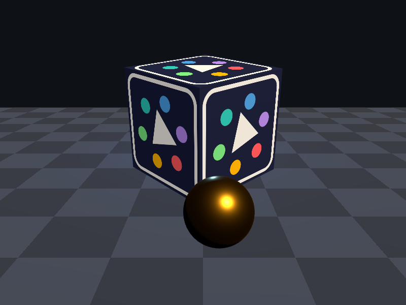

# ThreeAS

[three.js](https://threejs.org) for Rive. Scenes are written in AnimaScript
with three.js's API, rendered with Rive's `GPUCanvas`, and composited into
the artboard, so they sit in layouts, take script inputs, and can show live
Rive artboards as textures.



```as
import * as THREE from "lib:threeas/three/Three";

const scene = new THREE.Scene();
const camera = new THREE.PerspectiveCamera(75, width / height, 0.1, 1000);
const renderer = new THREE.GPURenderer(context, { antialias: true });

const cube = new THREE.Mesh(
    new THREE.BoxGeometry(1, 1, 1),
    new THREE.MeshStandardMaterial({ color: 0x44aa88, roughness: 0.4 }));
scene.add(cube);
scene.add(new THREE.DirectionalLight(0xffffff, 3));

// in draw(renderer):
renderer.render(scene, camera);
renderer.present(riveRenderer);
```

A live artboard as a texture:

```as
@input screen: Artboard? = null;
...
const texture = new THREE.ArtboardTexture(screen!, 512, 512);
material.map = texture;
// in advance(seconds):
texture.advance(seconds);
```

Or as an app, with controls and pointer handling done for you:

```as
import * as THREE from "lib:threeas/three/Three";
import { OrbitControls } from "lib:threeas/three/addons/controls/OrbitControls";

export class Demo extends THREE.ThreeLayout {
    cube: THREE.Mesh = new THREE.Mesh(new THREE.BoxGeometry(), new THREE.MeshNormalMaterial());
    override setup(context: Context): bool {
        this.scene.add(this.cube);
        this.camera.position.z = 3;
        this.controls = new OrbitControls(this.camera, this.renderer);
        return true;
    }
    override animate(seconds: f64): void {
        this.cube.rotation.y += seconds;
    }
}
```

A ThreeLayout forwards pointer events to the interactive ArtboardTextures
under the pointer. It stays cheap in big scenes: it raycasts only the
meshes that show one, then checks for an occluder in front (`layout.picker`,
an `ArtboardPicker`; set `picker.occluders` to narrow that), updates world
matrices once a frame (call `invalidatePointer()` after moving objects in a
pointer hook), and raycasts of big geometries go through a bounding volume
hierarchy built in a job (`GeometryBVH`).

## Two projects

The repository holds two Rive CLI projects (each a directory with its own
`rive.yaml`):

```
packages/threeas/   the engine, published as the Rive library "threeas"
  three/            the library: three.js's src/ layout, addons/, rive/, shaders/
  tests/            rive --test suites, and fixtures/ they read by name
  threeas.rml       a placeholder artboard (the library's file needs markup)
  bindings/         the push binding per environment (tools/publish.sh)
packages/gallery/   the gallery and every example, built on the engine
  gallery/          the landing page: gallery.rml, its generator, brand, fonts, thumbs, hero
  examples/<name>/  one example each: <name>.as, <name>.rml (its artboards), its assets
  examples/shared/  what several examples use (the Screen artboard, studio_rgbe.hdr)
  threeas.rml       the engine library import (written by rive library add/update)
  .libraries/       the published engine snapshot the gallery builds against (git-ignored:
                    `rive library update packages/gallery --uat` downloads it)
tools/              scripts across both: publishing, screenshots, bench, samples
docs/               DEVIATIONS.md, PERFORMANCE.md, screenshots
```

The gallery imports the engine as a Rive library, the way any project
would: `"lib:threeas/<path in the library>"`, e.g. `lib:threeas/three/Three`.
Its `rive.yaml` names the library and sets `override: ../threeas`, so the
gallery builds against the engine sources next door and an engine script edit
shows in the gallery without publishing. The override replaces the
library's published scripts with the local ones and compiles
local scripts the published version lacks; engine shaders (both new `.wgsl`
files and edits to existing ones, where the `.libraries/` snapshot wins)
only reach the gallery once the library is republished and the
gallery updated (`tools/publish.sh`; see `AGENTS.md` for previewing a local
`three.wgsl` change). Baked shader variants are the
project's own (`threeas_baked/`, below), so they need no republish.

## Run it

Needs the Rive CLI (`rive --version` 1.10.0 or later).

```bash
cd packages/gallery
rive .                                            # live preview: the Gallery
rive . --artboard=FirstScene                      # the scene above
rive . --artboard=HelloCube                       # three.js's first tutorial
rive . --artboard=Geometries                      # every built-in geometry
rive . --artboard=Materials                       # materials, lights, fog, sky
rive . --artboard=Primitives                      # instancing, points, lines, sprites
rive . --artboard=Shapes                          # curves, extrusion, a Rive path in 3D
rive . --artboard=Interactive                     # orbit, click a Rive switch in 3D, render target
rive . --artboard=Deform                          # GPU skinning and morph targets
rive . --artboard=Model                           # a glTF model, animated
rive . --artboard=Models                          # glTF extensions, meshopt, Draco, SVG, FBX
rive . --artboard=CustomShader                    # a WGSL ShaderMaterial on a live artboard
rive . --artboard=Environment                     # image-based lighting
rive . --artboard=Environments                    # cube map, .hdr, .exr environments; CubeCamera
rive . --artboard=Textures                        # uv transforms, uv1, KTX2 compressed textures
rive . --artboard=MaterialsPlus                   # extra maps, glass, iridescence, anisotropy
rive . --artboard=Clipping                        # clipping planes, stencil caps, clipShadows
rive . --artboard=Lights                          # area lights, lamps, a light probe, CSM moonlight
rive . --artboard=Editor                          # helpers, controls, scene utilities
rive . --artboard=Batched                         # BatchedMesh: 600 instances, four geometries
rive . --artboard=Shadows                         # directional, spot and point shadows
rive . --artboard=PostProcessing                  # EffectComposer: bloom, tone mapping, FXAA
rive . --artboard=Addons                          # Water, Sky, Lensflare, Reflector, Refractor, metaballs
rive . --artboard=Water                           # Water, Water2, Reflector, Refractor, tuned live
rive . --artboard=GpgpuBirds                      # GPUComputationRenderer: 1024 flocking birds
rive . --artboard=GamesFps                        # Octree + Capsule collisions: walk, jump, throw
rive . --artboard=Benchmark --bench=300           # 1000 meshes + 10000 instances, timed
rive . --screenshot=build/s.png --advance=1s      # headless render

cd packages/threeas
rive . --test                                     # the engine's test suites
```

## Gallery

`packages/gallery/gallery/` is the project's landing page, built in Rive
(RML, no HTML) in rive.app's style: a hero over a screenshot of the Lights
example, a card per example, install, quickstart and features. It is made
of Rive layouts, so it reflows to the window (two columns when wide, one on
a phone) and scrolls. Clicking a card plays that example artboard live on
the page's stage, at the stage's size, with its pointer input (orbit, zoom,
clicks). The stage sits above the cards and sticks to the top of the window
while they scroll under it, then leaves with the Examples section.

```bash
cd packages/gallery
rive . --artboard=Gallery                         # the landing page
python3 gallery/make_gallery.py                   # regenerate gallery/gallery.rml
python3 gallery/make_gallery.py --thumbs          # ... and the thumbnails and hero image (macOS)
```

The stage is a nested artboard whose artboard is bound to a view model
property that the cards' listeners write, so the example artboards are
marked `isComponent="true"` in their `examples/<name>/<name>.rml`. Rive has
no sticky positioning: the page binds laid-out values (the stage slot's
position, the grid's height, the window's size) back into its view model,
and formula converters derive the stage's offset and height from them. The
cards that pass behind the stage are clipped off, which also keeps them
from the pointer.

## What is there

Milestone 1: math (Vector2/3/4, Quaternion, Euler, Matrix3/4, Color,
MathUtils), Object3D, BufferGeometry, Scene, Group, Mesh, perspective and
orthographic cameras, Box/Plane/Sphere geometries (and, from M2,
Circle/Ring/Cylinder/Cone/Torus/TorusKnot/Lathe/Capsule/Polyhedra/Edges/
Wireframe, Box3/Sphere/Plane/Ray/Triangle/Frustum, frustum culling), Basic/Normal/Lambert/
Standard materials, ambient/directional/point lights, Texture, DataTexture,
CanvasTexture, TextureLoader, ArtboardTexture, and `GPURenderer` (MSAA,
depth, transparency sorting, sRGB output). The milestones since are in
[PLAN.md](PLAN.md).

## Use it in another project

Import the library (needs a Rive account; `scripting: wasm` in the
project's `rive.yaml`), then import its modules by their path in the
library:

```bash
rive login
rive library search                    # the libraries this project may import, with ids
rive library add --library=<id>        # e.g. the threeas library
```

```as
import * as THREE from "lib:threeas/three/Three";
import { GLTFLoader } from "lib:threeas/three/addons/loaders/GLTFLoader";
```

Or copy `packages/threeas/three/` into the project (shaders included) and
import it by relative path (`"../three/Three"`).

## Optimizing shaders for your project

Every built-in material draws with one uber-shader
(`three/shaders/three.wgsl`) that picks its features (maps, lights, fog,
shadows ...) by uniform branches: nothing to compile per material, and it
draws anything. On GPU-bound scenes, shader variants specialized for what a
project actually draws are faster (three.js's per-material programs; in the
gallery, AOT render time went from 2.4 to 1.0 ms on Benchmark and 0.8 to
0.1 ms on Environment, see [docs/PERFORMANCE.md](docs/PERFORMANCE.md)).
`tools/threeas_bake.sh` bakes them into your project; it is optional, and
works on any project that imports the library:

```bash
git clone <this repository> threeas                        # for the tool
threeas/tools/threeas_bake.sh path/to/my_project           # record, bake, report
threeas/tools/threeas_bake.sh path/to/my_project --check   # CI: still fresh?
threeas/tools/threeas_bake.sh path/to/my_project --clean   # back to the uber-shader
```

It plays every artboard of the project headless for 3 s (one `rive`
build) while the renderer logs the program key of each draw (three.js's
`getProgramCacheKey`: material type, maps, lights by type, fog, shadows,
flat shading ...), then writes one variant per key into
`my_project/threeas_baked/` (`v_<hash>.wgsl`, plus `keys.txt` for people
and `--check`) and reports the keys per artboard, the variants written, the
estimated growth of the `.riv` and the keys `--max` left out. Commit the
folder with the project: the variants are shader assets of the project, and
the renderer finds a draw's variant by its name, a hash of the key and of
the `three.wgsl` the project runs (the one in `.libraries/`). A draw with no
variant, or a bake left over from another version of the library, simply
uses the uber-shader.

- Scenes are made by script code at runtime, so what is not drawn while
  recording is not baked. `--time=10s` plays longer; `--scenario=FILE`
  (repeatable) plays a `rive --commands` script (`pointer`, `data`,
  `advance` ...) for states reached by interaction; `--keys=FILE` adds the
  keys logged by `rive my_project --arg threeShaderKeys=1` while someone
  played it. `--artboard=A,B` or `--main` records fewer artboards;
  `--dry-run` reports without writing.
- Cost: each variant adds about 0.5 MB to the `.riv` (it is compiled for
  every shader backend; `shaderOutputs` in `rive.yaml` drops backends you
  do not ship) and one pipeline compile when first drawn. `--max=N`
  (default 48) bakes the keys most artboards share first.
- Rebake after updating the library (`rive pull`) or changing materials or
  lights; `--check` fails when the bake no longer matches. Before
  publishing, build a release `.riv` and run `tools/check_glsl.py` on it
  (WebGL2 compiles the variants too).
- `--engine=DIR` bakes from engine sources instead of the downloaded
  library: a library `override:`, or the engine copied into the project.
- Compare with and without the bake: `rive my_project --arg
  threeUberShader=1` (or `renderer.useBakedShaders = false`) ignores it.
  Baked and uber-shader renders match except for a few edge pixels.
- Needs bash, the Rive CLI and a threeas version with project bakes (the
  tool warns when the project's is older).

Publishing the library and the gallery is `tools/publish.sh` (see
[AGENTS.md](AGENTS.md)).

- [PLAN.md](PLAN.md): the milestones.
- [docs/DEVIATIONS.md](docs/DEVIATIONS.md): where and why the API differs
  from three.js. Read it before porting three.js code.
